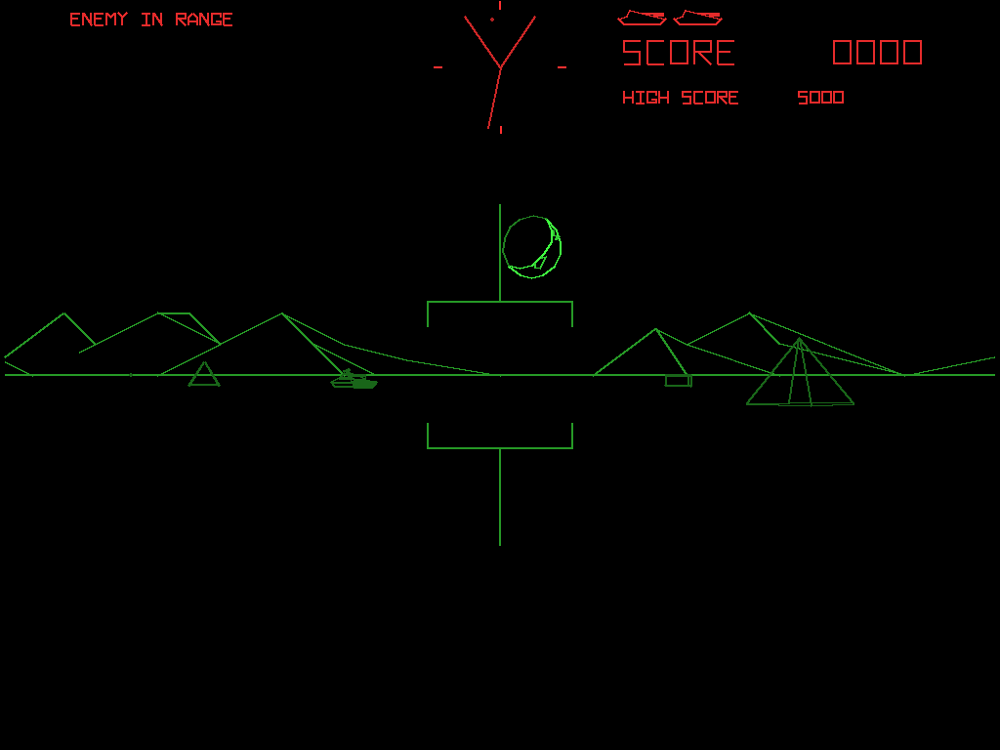
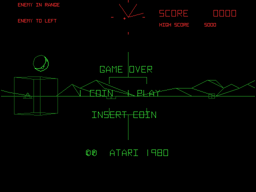

# Battlezone — disassembly and C port

An **AI-assisted disassembly of Battlezone** (Atari, 1980) and a complete,
playable **1:1 C port** of it — no emulation, no 6502 core at runtime; the
original program itself, translated one routine at a time. The reverse
engineering and the port were done together with an AI assistant
(Anthropic's Claude), with one rule enforced throughout: **no invented
data**. Every constant, table and branch traces to a ROM address, every name
is Atari's own identifier or a strict, documented expansion of it, and every
behavioural question was settled by running the ROM, not by guessing.

And a bonus: beside the port sits its **emulator twin**,
[`emu_src/`](emu_src/README.md). `bz_emu.exe` runs the real program ROM (your
own — none is included) on a 6502 core behind the very same window, beam
renderer, sound, controls and chip models as the port, so the original and
the translation can be played side by side.

<p align="center">
  
  &nbsp;
  
  <br>
  <sub>Left: the C port, <code>bz_win.exe</code>. Right: the emulator twin,
  <code>bz_emu.exe</code>, running the ROM. Both drawn headless by
  <code>tests\bz_smoke.exe</code>.</sub>
</p>

## What's in the repository

| where | what |
|-------|------|
| [`disasm/`](disasm/README.md) | the disassembly: the program ROM and the vector ROM as plain assembler source that re-encodes to the ROM byte for byte, a defines file carrying the memory map, the hardware registers and every RAM variable, a disassembly of the 149 bytes where the two known `$5000` chips differ, the hardware / Mathbox / mainline research notes, and the Python tools that generate and verify all of it from a ROM set — among them `macasm.py`, an assembler for Atari's own source dialect. [`disasm/bzone_shapes.html`](disasm/bzone_shapes.html) draws every vector object in the ROM |
| [`c_src/`](c_src/README.md) | the C port: the whole 6502 program as C11, one file per Atari module, **charging the ROM's own cycle count for every instruction path**; real AVG words built in vector RAM; the Mathbox running its real bit-slice microcode; a real POKEY behind the hardware seam; the self test; a Windows host (OpenGL beam renderer, XAudio2 sound with the discrete sounds as samples, keyboard / joystick treads); the oracle, the call-by-call verifier and their scenario scripts; and a prebuilt **`bz_win.exe`** with its **`bz_win.ini`**. Builds with Visual Studio 2022, no external SDK |
| [`emu_src/`](emu_src/README.md) | the bonus emulator: the real ROM, loaded from a MAME `bzone` or `bzonea` zip you supply, on the [AAE emulator](https://github.com/tcottrill/AAE)'s 6502 core — the only piece taken from AAE. Everything else is the port's own: the Windows host, `avg.c`, the Mathbox, the POKEY, the sounds and the board model. Same keys, same ini layout; a prebuilt **`bz_emu.exe`** with its own **`bz_win.ini`** |
| [`EMULATOR_PORT_NOTES.md`](EMULATOR_PORT_NOTES.md) | what the port proved about the board, written for anyone emulating it: the NMI and frame clocks, the AVG traps, the IN0 bits, the watchdog the self test relies on, the carries that cross routine boundaries, the sounds |

## Sources, and what is not included

This is not blind reverse engineering. Two earlier works made it possible,
and neither is distributed here.

- **Atari's own source code for Battlezone** — the MAC65 sources (`BZONE`,
  `BZMTNS`, `BZSOUN`, `VGUT`, `BZSTST`, `COIN65`, with `BZONE.DOC` and
  `BZONE.MAP`), published at
  [historicalsource/battlezone](https://github.com/historicalsource/battlezone).
  Re-assembling it with this project's own assembler reproduces the shipped
  **Revision 1** program ROM byte for byte, so **every routine name, variable
  name and instruction comment in the listings is Atari's**, placed on the ROM
  by locking the source's instruction stream against the bytes. Nothing was
  named to taste; [`disasm/README.md`](disasm/README.md) has the counts and
  the rules.
- **The emulators.** Hardware facts were cross-checked against the Battlezone
  driver of the [AAE emulator](https://github.com/tcottrill/AAE) and MAME's
  `bzone.cpp`; where they disagree, or a detail could not be pinned down from
  either, the notes say so rather than guess. The Mathbox and the AVG's state
  PROM are the very ones Tempest uses, so the Mathbox model and the
  cycle-true AVG timing come from the
  [Tempest port](https://github.com/tcottrill/Tempest-Full-Disassembly-and-C-Port),
  and `VGUT` is the Gravitar port's, unchanged.

The recovered listings are checked in, so nothing here needs Atari's archive
to build. The tools that read it expect it unzipped at `battlezone-main/`
beside `disasm/`.

## No ROMs included — bring your own

Atari's ROM images are not distributed here. The C port **builds, runs and is
verified call by call without them** — the ROM data the translated program
reads is checked in as generated C files and compiled into `bz_win.exe` and
into the oracle — but the disassembly tools read real ROM images, and the
emulator has nothing to run without one: it loads `emu_src\roms\bzone.zip`
(`--roms FILE` names another) and says so and exits if there is none.

Given a MAME `bzonea` set (and, optionally, `bzone` for the alternate chip),
one script builds the working image and regenerates and verifies every
listing:

```bash
python disasm/gen_from_roms.py <path-to-bzonea.zip-or-rom-dir> --check
```

The chips are found by part number and CRC32, not by file name, so a zip or a
directory of loose files both work. `--check` adds the independent assembler
round trip through [cc65](https://cc65.github.io) (`--cc65 DIR`).

### Sounds

Battlezone's explosions, shells and engine are discrete analogue circuits,
not POKEY; both programs play them from recordings, **MAME's `bzone` sample
set** converted to WAV: `FIRE.WAV`, `FIRE2.WAV`, `ENGINE1.WAV`,
`ENGINE2.WAV`, `EXPLODE1.WAV` and `EXPLODE2.WAV`, in `c_src\samples\` for
the C port and a copy in `emu_src\samples\` for the emulator. `[samples]` in the ini maps each sound to a file, so other
recordings can be dropped in; without any, the games run with the POKEY's
sounds only.

## Quick start

```bat
cd c_src
build_win.bat
bz_win.exe
```

Or run the prebuilt `c_src\bz_win.exe` on 64-bit Windows 10 or 11 (it needs
the Microsoft Visual C++ 2015-2022 x64 runtime, which most machines already
have). Keep `bz_win.ini` beside it; the host writes `bz_win.log` there.
Battlezone has no EAROM, so high scores last until the program closes, as
they do on the cabinet until it is switched off.

The emulator is the same, from `emu_src`, once a ROM zip is in place:

```bat
cd emu_src
build_emu.bat
bz_emu.exe
```

It keeps its own `bz_win.ini` and `bz_win.log` in `emu_src`, so the two
programs never share settings. The controls are the same for both, MAME's
Battlezone defaults:

| control | keys |
|---|---|
| left tread forward / reverse | E / D |
| right tread forward / reverse | I / K |
| single stick (both treads) | arrow keys; joystick d-pad |
| twin sticks | joystick left stick Y, right stick Y |
| fire | Space, Left Ctrl, joystick button 1 |
| coin — left / right mech | 5 / 6 |
| start 1 / 2 | 1 / 2 |
| self-test switch | F2 (a latched toggle; switching it on resets the board) |
| diagnostic step / reset / slam | F1 / F3 / F4 |
| fullscreen / quit | Alt+Enter / Esc |

The self test is the cabinet's, ported whole, and works as it does there: F2
reboots into it (the board reads the switch only at power-on), F1 steps
through the diagnostic patterns, and F2 again leaves it — the ROM sees the
switch go off and jumps back to power-on. The diagnostic patterns listen only
to the diag button; F3, the board's reset, is the way out of those. `--test`,
or `test_switch=1` in the ini, powers on straight into the self test.

The option switches are in `[dips]`, one word per group — lives, the score
the missile appears at, the bonus tanks, the language and the coinage. Every
setting is described in [`c_src/README.md`](c_src/README.md#bz_winini).

## The listing is Atari's source, re-assembled

| | |
|---|---|
| program ROM re-encoded from the listing and compared, `$5000-$7FFF` | **12,288 bytes, 0 mismatches** |
| independent ca65/ld65 assemble-and-link round trip | **12,288 bytes, 0 mismatches** |
| vector ROM re-encoded and compared, `$3000-$3FFF` | **4,096 bytes, 0 mismatches** — 12 pictures, 37 characters, 42 3-D objects |
| RAM-range operands decoded straight from the ROM, each inside a named cell | **1,441**, all covered or individually explained |
| routine headers, each with a description | **120** — 75 from Atari's source, 45 written here |
| RAM variables named and described | **121 of 121** |
| the alternate `bzone` `$5000` chip | its **149** differing bytes disassembled and re-encoded clean |

The target is **Revision 1** — MAME's `bzonea`, the image Atari's source
assembles to. The C port and the emulator run it; the emulator runs MAME's
parent `bzone` (Revision 2) as well.

## The C port is proven against the running ROM, call by call

`c_src/tests/refrun.c` is the oracle: the real program on a 6502 interpreter
with the board modelled around it — the 246 Hz NMI, the AVG's HALT line from
actually walking the display list, POKEY's RANDOM, the Mathbox microcode, the
3 kHz bit, the watchdog. `c_src/tests/lockstep.c` runs it and, at **every
call of every translated routine**, snapshots the machine at the ROM's `JSR`,
lets the ROM run to its `RTS`, then runs the C function from the same
snapshot with the ROM's hardware reads replayed, and compares all of RAM,
vector RAM, the I/O write sequence and — with `--cycles-strict` — **the
number of machine cycles the call took**.

| scripted run | routine calls compared | failed | cycle counts that differ |
|---|---|---|---|
| attract, 5,000 frames | 3,140,249 | **0** | **0** |
| coin, start and play, 3,000 frames | 1,759,516 | **0** | **0** |
| a long game, 4,000 frames | 2,511,834 | **0** | **0** |

Every routine of `BZONE`, `BZSOUN`, `COIN65` and `VGUT` is translated and
checked this way (calls an NMI landed inside are set aside, not counted as
passes; [`c_src/README.md`](c_src/README.md#verification) has the full
numbers). The self test (`BZSTST`) is translated too, and draws the same
screens as the ROM running in the emulator. Bugs lockstep caught in the hand
translation were almost all an inverted branch, a missing RAM side effect of
a register save, or a carry chained across a `CMP` — the list is in
[`EMULATOR_PORT_NOTES.md`](EMULATOR_PORT_NOTES.md#6-how-the-verification-was-done-reuse-this).

## Why the port counts cycles

Call-by-call lockstep proves each routine does what the ROM does *from the
same starting state*. It cannot prove the port reaches the same starting
states, and in Battlezone that turned out to matter.

The first playable build charged no machine time for translated code: a
whole game pass ran in an instant just after the frame NMI, and NMIs were
serviced only while the mainline waited for the next frame. Every routine
still passed lockstep — and **the enemy tank kept backing away from the
player**. The reason is in `R_EVAD` (`$6553`), the robot's evasion choice:
it reads the NMI counter `S_INTCT` and backs straight off when its low three
bits are zero, and turns aside otherwise. On the board the NMI keeps firing
while the pass runs, so by the time `ROBOT` looks, `S_INTCT & 7` is spread
over every value (the oracle: zero only 159 times in 1,379). In the port it
was zero **every time**. The same shortcut hid a second bug: POKEY's `RANDOM`
only moves with machine time, so two reads with no time between them
returned the same byte — the saucer always entered on the diagonal, "too
close", and a rock's speed and direction came from one random number.

A cost model (Tempest's approach: charge each pass an average fitted to the
oracle) cannot fix either, because both depend on *where inside the pass*
time has reached. So the port now carries **true cycle counting**: every
translated routine charges the 6502 cycles its ROM instructions take, path
by path — taken branches, page crossings, the `DTAB` push/`RTS` dispatch,
every loop — through `CYC()` in [`c_src/hw.h`](c_src/hw.h). The NMI is
taken at the first charge after it falls due, exactly as the 6502 takes it
between instructions, and every read of `RANDOM` or the 3 kHz bit is charged
up to its own instruction first. `lockstep --cycles-strict` holds all of it
to the ROM: **7.2 million calls, every one the same number of cycles as the
ROM.** `tools/cyc.py` gives any instruction range's cost from the listing,
and `tools/cyc_audit.py` checks every `CYC(n)` against the range its comment
names.

The result: the robot now runs with the NMI 9 to 13 ticks into a pass, as
the ROM does, and turns and waits to shoot instead of retreating; the saucer
comes out where it should; `tests\bz_smoke.exe --prand` forces 64 saucer
entrances and finds the old "same byte twice" in 1 of them, down from 64.

## Hardware, briefly

- **CPU:** 6502 at 1.512 MHz (12.096 MHz / 8). The NMI fires every 6,144
  cycles, **246.09 Hz** (the 3 kHz clock, 12.096 MHz / 4096, divided by 12);
  the self-test switch gates it off.
- **Two clocks, as on the board:** the NMI bumps `SYNC` once every 16 ticks,
  so the game runs at **15.4 passes a second**; it re-arms the vector
  generator every 6 ticks, so the picture is drawn **41 times a second**,
  double-buffered in vector RAM. The Windows build logs both: 246.1 NMI/s,
  15.4 passes/s, 41.0 pictures/s.
- **Display:** Atari's **Analog Vector Generator**, monochrome, with
  display lists in 4K of vector RAM at `$2000` calling into 4K of vector ROM
  at `$3000`. The tube is exactly ±256 × ±192 in AVG units; the red / green
  of the cabinet is a gel overlay, split at the horizon line.
- **Mathbox:** four Am2901 bit-slices running Atari's microcode, the same
  PROMs as Tempest's; it does the 3-D rotation of every point.
- **Sound:** one POKEY at `$1820`, and the discrete explosion, shell and
  engine circuits on the `$1840` latch.
- **Controls:** two tread sticks and the fire button through POKEY's
  `ALLPOT`; coins, slam, the self-test and diagnostic switches, the AVG's HALT
  and the 3 kHz clock on `IN0` at `$0800`.
- **Watchdog:** about 0.75 s without a strobe resets the board, and the self
  test *relies* on it to leave.
- **Program:** 12K of 6502 code at `$5000-$7FFF`, mirrored to `$FFFF` — the
  6502 decodes only 15 address bits here.

## Provenance and method

Re-assemble Atari's source and hold it against the ROM, so that every name
and comment is placed by the bytes, not by eye. Generate the listings from
that, and verify them twice, independently. Translate one routine at a time,
reproducing every store the ROM makes and every cycle it spends, against a
memory model generated from the same defines the listings assemble against.
Verify every call of every routine against the running ROM — its result and
its time.

## License

The disassembly, the tools, the C port and the emulator's own code are
released under the **GNU General Public License, version 2 or later**, the
same terms as MAME (see [`LICENSE`](LICENSE)). `c_src/c012294.c` (and its
copy in `emu_src`) carries MAME's BSD-3-Clause terms for the parts translated
from MAME's `pokey.cpp`, and keeps that attribution in its header. The
vendored framework files in `platform/windows/` keep their own headers and
their own terms, and so do the files in `emu_src/cpu/`: the 6502 core is the
AAE emulator's, released under The Unlicense, with its credits in its header.
The names and comments recovered from Atari's source archive remain Atari's;
the archive is not distributed here. The sound samples are MAME's `bzone`
set, recorded from the cabinet's sound board. Battlezone is a trademark of
its owner, and no ROM images are included.
